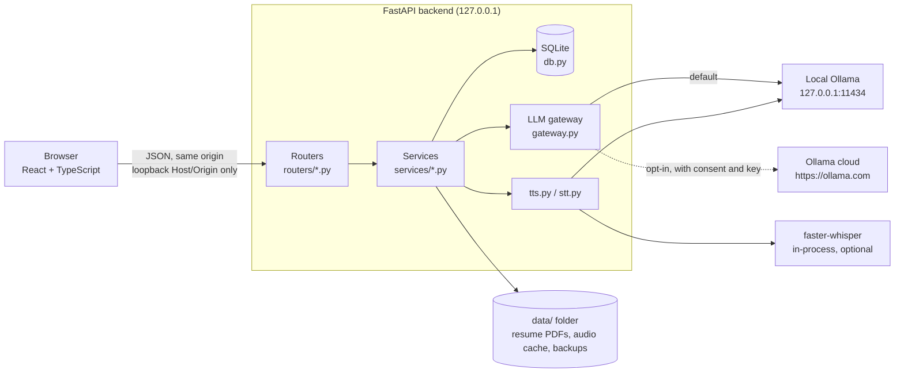

# Architecture

A short map of how Local AI Interviewer is put together. It is meant for contributors; user-facing behaviour is described in the
[README](../README.md). Everything here was checked against the source; file names point to where to look.

## Overview

One FastAPI process serves a JSON API under `/api` and, in production mode, the built React app at `/`. State lives in one SQLite
file. Language-model work goes to a local Ollama server by default; cloud models are an explicit opt-in. Speech runs locally.

## Layers

**Routers** (`backend/app/routers/`) validate input (Pydantic models in `schemas.py`), call a service and shape the response. They
hold no business rules. Groups: `library` (question sets, questions, import/export, rubric), `interviews`, `resumes`, `speech`, `ai`
(engine, API key, budget), `setup` (first-run checks, model download) and `system` (health, voices, stats, usage, evaluation
profiles, backup).

**Services** (`backend/app/services/`) contain the rules. They are built once in `backend/app/deps.py` (`build_container`) and
handed to routers through `app.state.c`. A service receives the database and other services in its constructor, which is how tests
swap in fakes.

**Database** (`backend/app/db.py`) is SQLite with one short-lived connection per unit of work and explicit transactions (writers
use `BEGIN IMMEDIATE`). The schema version is `PRAGMA user_version`; migrations are additive (see
[development.md](development.md#database-migrations)).

**Errors** are raised as `AppError` and rendered as `{"error": {"code", "message"}}` by `main.py`.

## The interview state machine

`services/interviews.py` implements a persisted state machine. An interview has a `status` (`in_progress`, `paused`, `completed`,
`ended`) and a `phase` (`awaiting_answer`, `evaluating`, `evaluation_failed`, `feedback`, `done`); each question is an item and each
attempt (the question and its follow-ups) is a turn.

- Every transition is one SQLite transaction with a compare-and-set on status, phase and the current turn id. A double click, a stale
  browser tab or a replayed request gets HTTP 409 and changes nothing.
- The answer is saved **before** the model is called and is never discarded when evaluation fails; the user presses Retry.
- On start-up, `recover()` turns any interview left in `evaluating` into `evaluation_failed`, so nothing hangs after a restart.
- The follow-up limit is frozen into the interview's configuration and enforced in code when the follow-up turn is created.

See [ADR 0003](adr/0003-adaptive-engine-pure-functions.md) for how adaptive mode fits into the same state machine.

## Evaluation pipeline

Between "Submit answer" and the score, `interviews._evaluate()` calls the evaluator, which does (details in
[evaluation.md](evaluation.md)):

1. optionally repair a voice transcript (one small model call);
2. choose an evaluation profile **by rules** (`eval_profiles.detect_category`);
3. make **one** schema-constrained grading call through the gateway (`prompts.py` builds the prompt; answers are fenced as untrusted
   data);
4. validate the reply with Pydantic, with one repair retry;
5. verify the cited evidence quotes against the answer and apply the consistency rules (`grounding.py`);
6. compute the weighted score, verdict and classification in code (`eval_profiles.score_answer`) — the model's own total is ignored
   ([ADR 0001](adr/0001-deterministic-scoring.md), [ADR 0002](adr/0002-evidence-grounding.md));
7. decide the follow-up in code (`evaluator.decide_followup`, or `adaptive.choose_followup` in adaptive mode);
8. store the evaluation with its provenance (prompt version, profile version, rubric fingerprint, model route, temperature, input hash).

## Adaptive engine

`services/adaptive.py` is a set of pure functions: given a snapshot of the question pool, the history and the engine state, it returns
the next decision and a plain-language reason. It has no database access, no model call and no randomness. The interview service
persists the decision, the engine state and an event log in the same transaction as the state change. Fixed mode keeps its original
code path. See [adaptive-interviews.md](adaptive-interviews.md).

## LLM gateway: local or cloud

`services/gateway.py` is the one place that decides which engine answers a request.

- **Local** (default): `services/ollama.py` talks to Ollama on loopback. The configuration refuses a non-loopback Ollama URL unless
  `ALLOW_NON_LOCAL_OLLAMA=1`.
- **Cloud** (opt-in): `services/cloud.py`. Switching to cloud mode needs a recorded consent and an API key; there is never an
  automatic switch from local to cloud. Roles: a *grader* model for grading, summaries and resume work, and a *conversation* model
  for follow-ups and transcript cleanup. Optional fallback model, optional fallback to the local model, and an optional spending
  budget checked before each call.
- Every reply's tokens, timings and (cloud) estimated cost are recorded locally by `services/usage.py` (the Model usage page).

Cloud mode has been verified against a fake server only (see README section 11).

## Resume pipeline

PDF upload (`routers/resumes.py`, `services/resumes.py`) then text extraction with optional OCR (`resume_extract.py`, pypdfium2 and
optional Tesseract), then AI organisation into an editable profile (`resume_profile.py`), then the user's corrections. On top of the saved
profile, `candidate_profile.py` and `tech_implications.py` compute the candidate profile and offline claim-grounded questions
deterministically with no model call ([ADR 0004](adr/0004-offline-resume-intelligence.md),
[resume-intelligence.md](resume-intelligence.md)). AI-written resume questions are in `resume_questions.py`. Resume content is only
sent to cloud models after a separate per-resume consent.

## Reports

`services/reports.py` assembles the report (scores, classification breakdown, difficulty and conceptual-vs-practical analytics,
progress); `report_pdf.py` renders the PDF with ReportLab. Exports (`GET /api/interviews/{id}/report/export`) support Markdown, JSON
and PDF; `redact=true` produces a share-safe copy without answers, evidence quotes or resume excerpts. The written summary is a
separate model call that can fail and be regenerated without losing the scores.

## Data stored and where

| What | Where |
|---|---|
| Question sets, interviews, turns, evaluations, reports, resumes (profiles), settings, model usage | SQLite: `data/interviewer.sqlite3` (WAL mode) |
| Optional cloud API key | the `settings` table of that database (see [SECURITY.md](../SECURITY.md)); `OLLAMA_API_KEY` in the environment avoids storing it |
| Resume PDFs | `data/resumes/<uuid>.pdf` |
| Generated question audio cache | `data/audio_cache/` (limit `AUDIO_CACHE_MB`) |
| Temporary copy made for the backup download (`GET /api/backup`) | `data/backups/` |
| Temporary microphone uploads and OCR files | `data/tmp_uploads/`, `data/tmp/` |
| Logs | `logs/` (ids, sizes, timings only) |

The folder is `DATA_DIR` (default `data/`) and is git-ignored. Nothing is sent anywhere unless the user turns on cloud mode.

## Threading and locking

The backend is synchronous FastAPI code run in a thread pool, with these deliberate limits:

- **One LLM worker for interviews.** `InterviewService` uses `ThreadPoolExecutor(max_workers=1)`; evaluations queue behind each other.
- **One resume worker.** `ResumeService` has its own single-worker executor so resume work does not block grading. Both workers' model
  requests still go through the same local client.
- **One global local-model lock.** `OllamaClient.llm_lock` is held for the whole of each local chat request, so the model never runs
  two generations at once (important on 8 GB machines). An interview evaluation therefore waits for at most one small resume
  request.
- **Cloud:** `CloudClient` has its own lock, so one cloud request runs at a time.
- Speech synthesis and transcription each take their own lock (one at a time keeps memory flat).
- The model is unloaded when no interview or resume job is running (`LLM_UNLOAD_WHEN_IDLE`).

## Security boundaries

- **Loopback only.** The launcher refuses a non-loopback `APP_HOST` and binds uvicorn to `127.0.0.1`.
- **Host and Origin guard.** The middleware in `backend/app/main.py` rejects any request whose `Host` is not `127.0.0.1`, `localhost`
  or `[::1]` (HTTP 403, `forbidden_host`), and any state-changing request with a non-loopback `Origin` (`forbidden_origin`). This
  defends against DNS rebinding and cross-site requests. There is no CORS configuration: the UI is same-origin.
- **Untrusted text.** Answers, resume text and imported questions are fenced as data in every prompt, and model output is
  schema-validated.
- **Files.** Resume uploads are checked by PDF signature, size and page count and stored under server-generated names; the data
  folder is `0700` and the database files `0600` where the OS supports it.
- **No login.** The app is single-user; anyone with access to the logged-in desktop session can open it.

The full policy is in [SECURITY.md](../SECURITY.md).

## Frontend

React 19 with TypeScript, built by Vite. `frontend/src/App.tsx` routes by URL hash and lazy-loads one file per page from
`frontend/src/pages/`. `api.ts` is the typed client, `types.ts` mirrors the API models. Theming is done with CSS variables
(`styles.css`, `theme-dark.css`). In development Vite serves the UI on :3000 and proxies `/api` to the backend on :8000.

## Further reading

[evaluation.md](evaluation.md) · [adaptive-interviews.md](adaptive-interviews.md) · [resume-intelligence.md](resume-intelligence.md) ·
[ADR 0001](adr/0001-deterministic-scoring.md) · [ADR 0002](adr/0002-evidence-grounding.md) ·
[ADR 0003](adr/0003-adaptive-engine-pure-functions.md) · [ADR 0004](adr/0004-offline-resume-intelligence.md) ·
[development.md](development.md)
