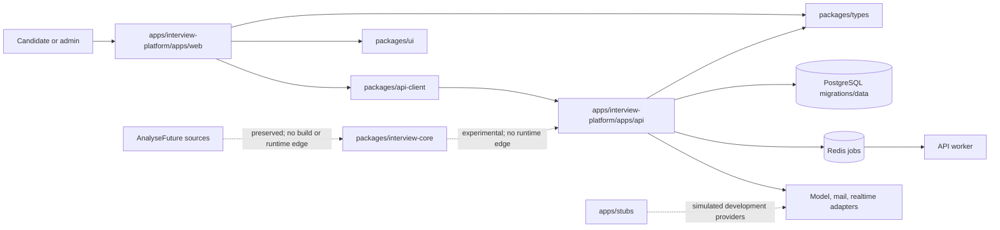

# Project Structure and Ownership

This document is the canonical contract for where every kind of file belongs, which directories are executable, and how the major parts depend on each other. The structure groups files by actual responsibility rather than extension.

## Complete current layout

```text
ai-interview/
├── apps/
│   └── interview-platform/       # single runnable development candidate
│       ├── apps/
│       │   ├── web/              # candidate/admin Next.js experience
│       │   ├── api/              # authenticated Express API and worker
│       │   └── stubs/            # deterministic offline provider simulation
│       ├── packages/
│       │   ├── api-client/       # typed API client
│       │   ├── types/            # shared contracts
│       │   └── ui/               # shared design primitives
│       ├── db/                    # PostgreSQL migration runner and migrations
│       ├── deploy/compose/        # local/AWS-connected service composition
│       ├── infra/                 # Docker images and Terraform
│       ├── e2e/                   # offline browser flows and fixtures
│       ├── scripts/               # application-specific operations
│       └── docs/api/              # generated OpenAPI reference
├── packages/
│   └── interview-core/           # standalone policy/evidence experiment
├── docs/
│   ├── product/                  # vision, requirements, features, market research
│   ├── architecture/             # system contracts, data, engine, ADRs
│   ├── engineering/              # setup, implementation, quality, models
│   ├── delivery/                 # roadmap, status, checklist, handoff
│   ├── operations/               # deployment and operational design
│   ├── governance/               # security, licensing, reuse, cost policy
│   ├── research/                 # dated source/runtime evidence
│   └── README.md                 # documentation index
├── scripts/                      # repository-wide validation and inventory tools
├── AnalyseFuture/
│   ├── archives/                 # original immutable ZIP inputs
│   ├── sources/                  # extracted untrusted research snapshots
│   ├── inventory/                # checksums, provenance, every-file catalog
│   ├── migrations/               # auditable one-time structure helpers
│   ├── README.md                 # research isolation policy
│   ├── SOURCE_INVENTORY.md       # source/license/security analysis
│   └── PROJECT_IDEA_AND_FUTURE_VISION.txt
├── .github/                      # path-scoped CI and collaboration templates
├── README.md                     # public entrypoint and truthful status
├── AGENTS.md                     # mandatory agent operating policy
├── CONTRIBUTING.md               # contributor and disclosure workflow
├── THIRD_PARTY_NOTICES.md        # release-critical legal attribution
├── REFERENCE_REPOSITORIES.txt    # dated external-source inventory
├── .gitignore                    # secret/data/build exclusion policy
├── .gitattributes                # vendored/generated/binary classification
└── PROJECT_STRUCTURE.md          # this ownership contract
```

## Runtime and dependency relationships



The dashed edges are intentionally non-runtime. Neither `packages/interview-core` nor anything under `AnalyseFuture` is an authority for production sessions, identity, persistence, or scoring.

## Ownership by functional collection

### `apps/interview-platform`

This is the only runnable application candidate. It owns the current UI, API, authentication, PostgreSQL schema, Redis jobs, provider adapters, reports, administration, Docker development stack, and Terraform. It remains a self-contained pnpm/Turbo workspace so its upstream-derived lockfile, licenses, relative build contexts, and internal package relationships stay intact.

Internal placement rules:

- `apps/web/src/app` contains routes, layouts, and request boundaries.
- `apps/web/src/components` contains presentation grouped by product area.
- `apps/web/src/lib` contains API, session, realtime, state, and formatting helpers.
- `apps/api/src/routes` and `controllers` define HTTP boundaries.
- `apps/api/src/services` owns use cases and authoritative business behavior.
- `apps/api/src/repositories` owns persistence and transaction boundaries.
- `apps/api/src/integrations` owns external systems and provider adapters.
- `apps/api/src/jobs` owns durable background processing and retries.
- `apps/api/src/security` and `middleware` own authentication and enforcement.
- Tests remain beside the application/package whose behavior they verify.

### `packages/interview-core`

This dependency-free package is a tested policy and evidence-validation experiment. It is not wired into the application's authentication, database, providers, or reports. A future ADR must either integrate useful rules into one authoritative engine or retain it as an experiment; two session authorities are not allowed.

### `docs`

The directory is organized by the decision a reader is trying to make:

- `product`: what to build and for whom;
- `architecture`: how authoritative components and data relate;
- `engineering`: how to develop, validate, and evolve implementation;
- `delivery`: what is complete, next, or blocked;
- `operations`: how the service would be deployed and operated;
- `governance`: what security, privacy, legal, reuse, and cost rules apply;
- `research`: dated factual investigations that should not silently become current status.

Use [docs/README.md](docs/README.md) as the navigation index. Architecture decisions live under `docs/architecture/decisions`; dated audits live under `docs/research/audits`.

### `AnalyseFuture`

This is a strict preservation and research boundary:

- `archives` contains the original source ZIPs without byte changes;
- `sources` contains exact extracted snapshots;
- `inventory` proves integrity and catalogs every tracked/pending file;
- `migrations` retains one-time mechanical reorganization logic for auditability.

Archived code is untrusted, non-runtime, outside active package workspaces, and excluded from normal build/test discovery. It must not be imported, executed, or deployed wholesale. Selective adoption requires exact provenance, license/security/privacy review, a scoped ADR, integration validation, rollback, and a maintenance owner.

## Complete file catalog

[AnalyseFuture/inventory/TRACKED_FILES.tsv](AnalyseFuture/inventory/TRACKED_FILES.tsv) contains one row for every tracked or pending repository file at generation time. Each row records:

- repository path;
- byte size and SHA-256 digest;
- functional category;
- content role;
- runtime status;
- purpose and relationship to the owning collection.

This catalog uses paths and file contents/roles, not extensions alone. Rebuild it after structural changes with `python3 scripts/build_repository_inventory.py`.

## File-placement rules

1. Put active user-facing processes inside the selected application workspace.
2. Put reusable code under `packages/` only when a documented application or experiment owns it.
3. Put repository-wide automation in root `scripts/`; application-only scripts stay with the application.
4. Keep infrastructure with the runtime it deploys until an approved migration creates a shared infrastructure boundary.
5. Put maintained product and engineering knowledge in the matching `docs` category.
6. Put original third-party research and extracted copies only under `AnalyseFuture`.
7. Keep legal licenses/notices with the source they govern; retain project-level attribution at root.
8. Never commit secrets, private candidate data, recordings, databases, dependencies, generated model weights, or build outputs.
9. Do not create empty directories to imitate a target architecture.
10. Preserve history with Git-aware moves; never force-push to reorganize paths.

## Language strategy

- TypeScript is the primary product language for web, API, contracts, session policy, and reports.
- SQL owns ordered relational schema evolution.
- Terraform, YAML, Dockerfiles, and shell are operational support languages.
- Python is allowed only behind explicit boundaries where ML, speech, evaluation, or training ecosystems provide measured value.
- A language rewrite requires behavioral parity tests and an operational benefit; visual consistency is not sufficient.

## Structural change gates

A future move is complete only when:

- every file remains present or has a documented successor;
- Git recognizes moves as renames where practical;
- imports, links, CI paths, Docker contexts, deployment paths, and developer commands are updated;
- licenses and notices remain correct;
- runtime and research boundaries remain explicit;
- the relevant validation is run when the task permits it;
- rollback is possible without force-pushing.

See [the source inventory](AnalyseFuture/SOURCE_INVENTORY.md), [integrity metadata](AnalyseFuture/inventory/README.md), and [ADR 0003](docs/architecture/decisions/0003-candidate-foundation.md).
