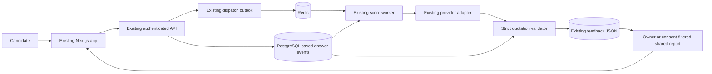

# Recovery architecture and ownership

The current maintained product remains `apps/interview-platform`, one pnpm/Turbo workspace. Recovery did not migrate directories merely to resemble a target tree. The repository-wide structure is documented in [PROJECT_STRUCTURE.md](../../PROJECT_STRUCTURE.md); this document records ownership of the implemented recovery slice.

| Owner | Responsibility and dependencies |
| --- | --- |
| `apps/web/src/app` and `src/lib/auth.tsx` | Next.js candidate/admin routes and one client session store; existing API authentication remains authoritative |
| `apps/api/src/routes`, `controllers`, `middleware`, `security` | HTTP validation, owner/role checks, passwords and sessions; no research authentication systems are mounted |
| `apps/api/src/services/interview/text-practice.service.ts` | Consent, frozen question position, transactional event persistence, concurrent submissions and retries |
| `apps/api/src/jobs/interview.jobs.ts` | Existing planning/scoring handlers; written scoring loads only that question's persisted ANSWER events |
| `apps/api/src/domain/text-evidence.ts` | Strict output/evidence validation; no model calls, session state machine or data access |
| `apps/api/src/services/interview/prompts.ts` | Server-defined rubric and fenced model inputs; role and answer-event data are outside system instructions for written scoring |
| `apps/api/src/services/interview/ai.ts`, `integrations/llm` | Existing structured generation, adapters and usage accounting; no additional verifier call or SDK |
| `apps/api/src/integrations/http.ts` | Provider networking, timeout/failure classification; logs metadata rather than upstream bodies |
| `apps/api/src/jobs/score-outbox.ts` | Transactional answer-to-queue dispatch and delivery recovery |
| `db/migrations`, `apps/api/src/db` | Primary PostgreSQL schema/types; feedback evidence stored in existing `answers.feedback` JSON, no schema migration |
| `services/interview/report.service.ts`, `presenters/interview.presenter.ts` | Existing owner reports and DTOs; suppress whole grounded feedback on shares without transcript consent |
| `apps/web/src/components/report/report-body.tsx` | Escaped citations, observation links, abstentions, legacy fallback and simulated/provider labels |
| `packages/types`, `api-client`, `ui` | Shared contracts, existing client and design primitives; `TextFeedbackEvidence` is an optional backward-compatible feedback field |
| `apps/stubs` | Synthetic development providers; grounded demo feedback is explicitly simulated, not an ability assessment |
| `packages/interview-core` | Preserved experimental policy contract; no second runtime authority introduced |
| `AnalyseFuture` | Protected recovery inputs and source implementations; retain until individually justified dispositions and integration evidence exist |

The validator establishes that a quotation occurs in an allowed saved answer, not that a judgment is technically correct. Schema-valid output remains untrusted until checked against authoritative events. Confidence is model-reported and uncalibrated. Voice/code scores are outside this new contract and must not be described as grounded by it.

Rollback uses ordinary Git reverts of the scoped implementation commits. No database rollback or user-data deletion is required. Optional JSON evidence can remain on saved answers; new UI handles old feedback without it. Reverting the privacy fix reintroduces unsafe logging and is not recommended. Preserve the recovery baseline and archives regardless of any implementation rollback.
